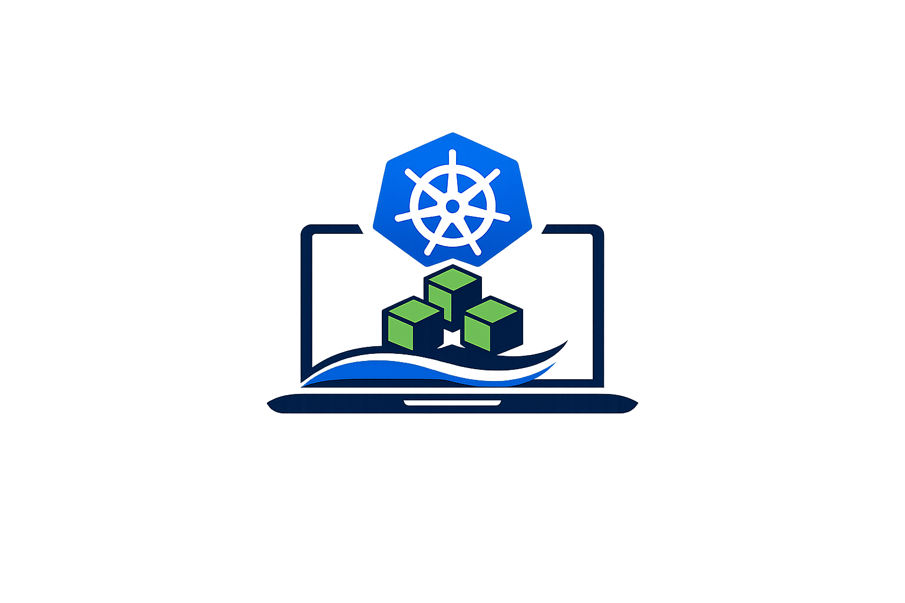
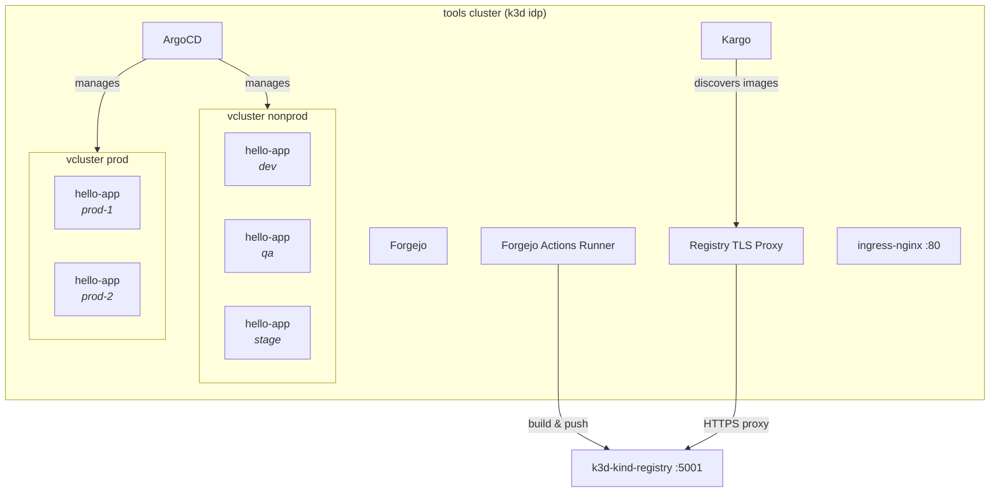

<p align="center">
  
  <br><br>
  <strong style="font-size:1.5em;">IDP — Internal Developer Platform</strong>
  <br>
  <em>A local multi-cluster GitOps platform running on <a href="https://k3d.io/">k3d</a> and <a href="https://www.vcluster.com/">vcluster</a>, managed by <a href="https://argo-cd.readthedocs.io/">ArgoCD</a>.</em>
</p>

## Quick Start

```bash
make run      # create clusters, install infra, activate GitOps
make status   # show platform status
make stop     # stop clusters without losing state
make start    # resume previously stopped clusters
make clean    # tear everything down
```

## Architecture



One k3d node is the tools cluster. Two vclusters on that node hold the environments: `nonprod` has namespaces `dev`, `qa`, and `stage`; `prod` has `prod-1` and `prod-2`. Promotion is dev → qa → stage, then prod-1 and prod-2 side by side.

| Cluster | What it is | Runs | Port |
| ------- | ---------- | ---- | ---- |
| `tools` | the k3d cluster, named `idp` | Argo CD, Forgejo, Kargo, Actions runner, registry proxy, the only ingress-nginx | `:80` |
| `nonprod` | vcluster | hello-app in `dev`, `qa`, and `stage` | `:80` |
| `prod` | vcluster | hello-app in `prod-1` and `prod-2`, one replica each | `:80` |

The tools ingress serves every hostname on port 80. A hostname is `<svc>.<ns>.<cluster>.idp.localhost`, for example `hello-app.qa.nonprod.idp.localhost` and `kargo.kargo.tools.idp.localhost`. Argo CD on the tools cluster manages itself and both vclusters.

Argo CD, Forgejo, and Kargo set memory requests and limits. Dex, notifications, the Kargo external webhook receiver, and Kargo API TLS are off. Give Docker about **8 GiB**. Image builds still spike above that because the Actions runner uses Docker-in-Docker.

## Repository Structure

```
.
├── scripts/                  # Playground scripts (run, clean, sync, status, stop, start)
├── k3d/                      # Tools cluster config
├── bootstrap/                # Tools bootstrap and shared vcluster values
├── docs/                     # Platform and delivery specs
│
├── actions/                  # Shared CI, published as the actions repo
│   ├── build.sh
│   └── .forgejo/workflows/build-and-push.yaml
│
├── gitops/                   # Desired state, published as the gitops repo
│   ├── infrastructure/       # Shared bases (namespace and manifests)
│   │   └── <app>/
│   ├── applicationsets/      # ArgoCD ApplicationSet declarations
│   │   └── <app>.yaml        # Git directory generator → clusters/*/*/<app>
│   ├── apps/                 # App base manifests (Deployment, Service, Ingress, …)
│   │   └── <app>/
│   └── clusters/             # One overlay per target
│       └── <cluster>/
│           └── <namespace>/
│               └── <app>/    # clusters/tools/kargo/kargo, clusters/nonprod/qa/hello-app, …
│
├── projects/                 # Application source code + CI workflows
│   └── <app>/
│
└── Makefile
```

## How It Works

### Setup Flow (`make run`)

0. **k3d** — create the registry and the tools cluster
1. **Bootstrap** — install Argo CD, Forgejo, and cert-manager, register the Actions runner, and install the two vclusters
2. **Register** — give Argo CD a cluster secret for the tools cluster and each vcluster from the vcluster admin client certificate
3. **Repos** — create the Forgejo repositories through the API
4. **Sync** — publish `gitops/`, `actions/`, and each `projects/*` to its own Forgejo repo
5. **Activate** — apply the root Application that tracks `gitops/applicationsets/`

### CI Pipeline

Each project in `projects/` includes a Forgejo Actions workflow (`.forgejo/workflows/ci.yaml`) that runs on push to `main`. The workflow calls the shared build-and-push workflow in the `actions` repo (`actions/.forgejo/workflows/build-and-push.yaml`), which runs `actions/build.sh` and pushes the image to the local registry (`k3d-kind-registry:5000`).

The Forgejo Actions runner is deployed as a pod with a DinD (Docker-in-Docker) sidecar on the tools cluster, managed by ArgoCD via the `forgejo-actions` ApplicationSet. Runner configuration and DinD daemon config are generated by Kustomize `configMapGenerator` from plain files (`config.yaml`, `daemon.json`). Setup generates a local registration secret. A bootstrap Job registers that runner once Forgejo is ready, and the runner pod reads the same secret. The first project image is pushed by that workflow, not by `make run`.

> **Note:** The shared workflow checks out `idp/actions` with `ref: main`. Forgejo 15 serves the compare API that `actions/checkout` uses, so this is no longer the Gitea workaround from [go-gitea/gitea#29654](https://github.com/go-gitea/gitea/issues/29654). The ref stays so the actions repo is taken from `main`.

### CD Pipeline

Kargo handles continuous delivery. A **Warehouse** watches the container registry for new image tags. When a new tag is detected, Kargo creates a **Freight** and promotes it through a pipeline of **Stages** (one per environment). Each Stage runs promotion steps: `git-clone` → `kustomize-set-image` → `git-commit` → `git-push` → `argocd-update`.

Since the registry is HTTP-only, an nginx-based **TLS reverse proxy** (`registry-tls-proxy`) on the tools cluster provides HTTPS for Kargo image discovery. The proxy generates its own certificate when the pod starts. Kargo's admission webhooks use the chart default and ask cert-manager for a certificate. The API itself is HTTP behind the ingress, and the external webhook receiver is off.

See [progressive-delivery.md](docs/progressive-delivery.md) for the full promotion strategy and rollout specification.

### GitOps Loop

The `gitops/applicationsets/` directory contains ApplicationSet declarations. Each one uses a **git directory generator** that scans `clusters/*/*/<app>`. Every target uses the same path:

```
clusters/<cluster>/<namespace>/<app>/kustomization.yaml
```

`tools` is the k3d cluster. `nonprod` and `prod` are the vclusters. Each matching directory becomes an ArgoCD Application. The kustomization references a shared base and applies the patches for that target. Forgejo is the exception that bootstrap applies directly: its runner secret is generated locally and is not in the GitOps repo.

### Adding a New App

1. Create the base manifests in `gitops/apps/<name>/`
2. Create overlays in `gitops/clusters/<cluster>/<namespace>/<name>/`
3. Create an ApplicationSet in `gitops/applicationsets/<name>.yaml`
4. Run `make sync` to push changes to Forgejo

### Adding a New Cluster Target

1. Create `gitops/clusters/<cluster>/<namespace>/<app>/kustomization.yaml`
2. Run `make sync` — ArgoCD auto-discovers the new directory

### Platform Status (`make status`)

```
  NAME                                     STATUS             URL                                        CREDENTIALS
  ──────────────────────────────────────── ────────────────── ────────────────────────────────────────── ────────────────────
  argocd                                   Healthy            http://argocd.argocd.tools.idp.localhost       admin / ••••••••
  forgejo                                  Healthy            http://forgejo.forgejo.tools.idp.localhost     idp / ••••••••

  forgejo-actions
  forgejo-actions-forgejo-tools            Synced/Healthy     -                                          -

  hello-app
  hello-app-dev-nonprod                    Synced/Healthy     http://hello-app.dev.nonprod.idp.localhost -
  hello-app-qa-nonprod                     Synced/Healthy     http://hello-app.qa.nonprod.idp.localhost  -
  hello-app-stage-nonprod                  Synced/Healthy     http://hello-app.stage.nonprod.idp.localhost -
  hello-app-prod-1-prod                    Synced/Healthy     http://hello-app.prod-1.prod.idp.localhost -
  hello-app-prod-2-prod                    Synced/Healthy     http://hello-app.prod-2.prod.idp.localhost -

  ingress-nginx
  ingress-nginx-ingress-nginx-tools        Synced/Healthy     -                                          -

  kargo
  kargo-kargo-tools                        Synced/Healthy     http://kargo.kargo.tools.idp.localhost     admin / ••••••••

  kargo-pipeline
  kargo-pipeline-hello-app-tools           Synced/Healthy     -                                          -

  registry
  registry-registry-tools                  Synced/Healthy     -                                          -
```

## Commands

| Command       | Description                                           |
| ------------- | ----------------------------------------------------- |
| `make run`    | Provision infrastructure and activate GitOps          |
| `make stop`   | Stop clusters without losing state (docker stop)      |
| `make start`  | Resume previously stopped clusters (docker start)     |
| `make clean`  | Destroy the clusters and the local registry           |
| `make sync`   | Publish gitops, actions, and project folders to Forgejo |
| `make status` | Show platform status                                  |
| `make help`   | List all targets                                      |

## Prerequisites

- [docker](https://docs.docker.com/get-docker/)
- [k3d](https://k3d.io/)
- [kubectl](https://kubernetes.io/docs/tasks/tools/)
- [kustomize](https://kubectl.docs.kubernetes.io/installation/kustomize/)
- [helm](https://helm.sh/docs/intro/install/)
- curl, git
