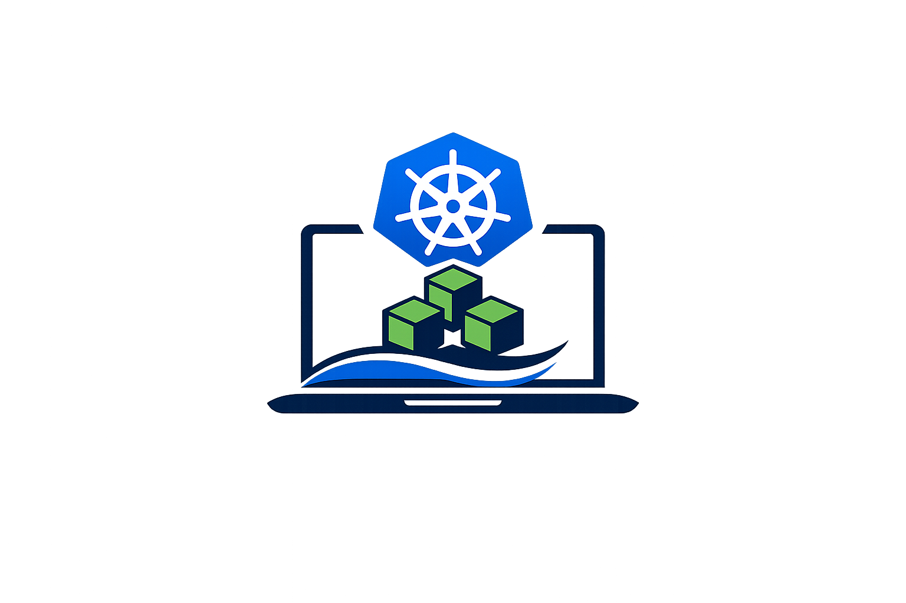
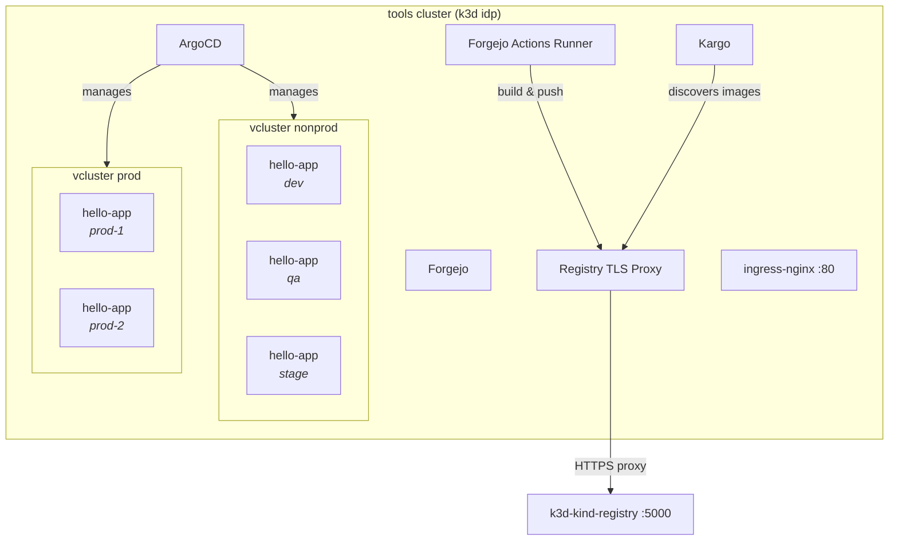

<p align="center">
  
  <br><br>
  <strong style="font-size:1.5em;">IDP — Internal Developer Platform</strong>
  <br>
  <em>A local multi-cluster GitOps platform running on <a href="https://k3d.io/">k3d</a> and <a href="https://www.vcluster.com/">vcluster</a>, managed by <a href="https://argo-cd.readthedocs.io/">ArgoCD</a>.</em>
</p>

## Quick Start

```bash
make run      # create clusters, install infra, activate GitOps
make status   # show platform status
make stop     # stop clusters without losing state
make start    # resume previously stopped clusters
make clean    # tear everything down
```

## Architecture



One k3d node is the tools cluster. Two vclusters on that node hold the environments: `nonprod` has namespaces `dev`, `qa`, and `stage`; `prod` has `prod-1` and `prod-2`. Promotion is dev → qa → stage → prod. prod is a manual gate with no deploy, and prod-1 and prod-2 promote from it automatically.

| Cluster | What it is | Runs | Port |
| ------- | ---------- | ---- | ---- |
| `tools` | the k3d cluster, named `idp` | Argo CD, Forgejo, Kargo, Actions runner, registry proxy, the only ingress-nginx | `:80` |
| `nonprod` | vcluster | hello-app in `dev`, `qa`, and `stage` | `:80` |
| `prod` | vcluster | hello-app in `prod-1` and `prod-2`, one replica each | `:80` |

The tools ingress serves every hostname on port 80. A hostname is `<svc>.<ns>.<cluster>.idp.localhost`, for example `hello-app.qa.nonprod.idp.localhost` and `kargo.kargo.tools.idp.localhost`. Argo CD on the tools cluster manages itself and both vclusters.

Argo CD, Forgejo, and Kargo set memory requests and limits. Dex, notifications, the Kargo external webhook receiver, and Kargo API TLS are off. Give Docker about **8 GiB**. Image builds still spike above that because the Actions runner uses Docker-in-Docker.

## Repository Structure

```
.
├── scripts/                  # Playground scripts (run, clean, sync, status, stop, start)
├── k3d/                      # Tools cluster config
├── bootstrap/                # Tools bootstrap and shared vcluster values
├── docs/                     # Platform and delivery specs
│
├── actions/                  # Shared CI, published as the actions repo
│   ├── build.sh
│   └── .forgejo/workflows/build-and-push.yaml
│
├── kubernetes/               # Control plane. Each module has base/ and envs/
│   ├── argocd/               # Argo CD install, bootstrap, and ApplicationSets
│   ├── kargo/                # Kargo install
│   │   ├── base/             # Namespace and the bundle ClusterPromotionTask
│   │   ├── components/       # Git credentials and the tools ProjectConfig
│   │   ├── envs/tools/       # Helm values for the tools destination
│   │   └── projects/<name>/  # One Kargo Project: Warehouse, Stages, and app tasks
│   └── <component>/          # base/, plus envs/<destination>/ for each variation
│
├── projects/                 # Application source, CI, and deploy manifests
│   └── <app>/
│       └── deploy/
│           ├── base/         # Shared manifests, published with the app repo
│           └── envs/<stage>/ # dev, qa, stage, prod-1, prod-2
│
└── Makefile
```

## How It Works

### Setup Flow (`make run`)

0. **k3d** — create the registry and the tools cluster
1. **Bootstrap** — install Argo CD, Forgejo, and cert-manager, register the Actions runner, and install the two vclusters
2. **Kargo** — once cert-manager is ready, install Kargo from `kubernetes/kargo/envs/tools`. The controller has to be running before the first promotion
3. **Register** — give Argo CD a cluster secret for the tools cluster and each vcluster from the vcluster admin client certificate
4. **Repos** — create `platform`, `actions`, each `projects/*` repo, and an empty `gitops`
5. **Sync** — publish `kubernetes/<module>/` to `platform`, `actions/` to `actions`, and each `projects/*`. `gitops` is left empty
6. **Activate** — apply the root Application that tracks `kubernetes/argocd/applicationsets` on `platform`, then wait until the tools stages have committed `gitops` `main`. hello-app appears after its first image

### CI Pipeline

Each project in `projects/` includes a Forgejo Actions workflow (`.forgejo/workflows/ci.yaml`) that runs on push to `main`. The workflow calls the shared build-and-push workflow in the `actions` repo (`actions/.forgejo/workflows/build-and-push.yaml`), which runs `actions/build.sh` and pushes the image to `registry-tls-proxy.registry.svc.cluster.local`.

The Forgejo Actions runner is deployed as a pod with a DinD (Docker-in-Docker) sidecar on the tools cluster, managed by ArgoCD via the `forgejo-actions` ApplicationSet. Runner configuration and DinD daemon config are generated by Kustomize `configMapGenerator` from plain files (`config.yaml`, `daemon.json`). Setup generates a local registration secret. A bootstrap Job registers that runner once Forgejo is ready, and the runner pod reads the same secret. The first project image is pushed by that workflow, not by `make run`.

> **Note:** The shared workflow checks out `idp/actions` with `ref: main`. Forgejo 15 serves the compare API that `actions/checkout` uses, so this is no longer the Gitea workaround from [go-gitea/gitea#29654](https://github.com/go-gitea/gitea/issues/29654). The ref stays so the actions repo is taken from `main`.

### CD Pipeline

Kargo handles continuous delivery. hello-app has a **Warehouse** that watches the container registry. A new tag becomes **Freight** and moves through one **Stage** per environment. Each deploying stage calls the hello-app `set-image` PromotionTask. It sets the freight tag on `deploy/envs/<stage>` in the hello-app repo, renders that env to plain manifests, and replaces the gitops directory. The prod stage is a gate and does not call that task.

Each platform project under `kubernetes/kargo/projects/<name>/` has one stage, `tools`. That stage calls the shared `bundle` task, which renders `kubernetes/<project>/envs/<stage>` into `<cluster>/<namespace>/<project>`. The stage name is the env directory and the cluster. The namespace defaults to the project name. A second destination is another stage; these projects have one destination today. The `tools` stage promotes new Freight on its own. Those projects share `kubernetes/kargo/components/tools-project` for the promotion policy and `kubernetes/kargo/components/git-credentials` for Forgejo. hello-app uses the same git credentials.

Images are named `registry-tls-proxy.registry.svc.cluster.local/<repo>`. The registry container is HTTP-only, so an nginx **TLS reverse proxy** (`registry-tls-proxy`) on the tools cluster is the HTTPS front door for pushes and for Kargo. containerd pulls that same name through a mirror to `http://k3d-kind-registry:5000`, set in `k3d/registries.yaml`. The proxy generates its own certificate when the pod starts. Kargo's admission webhooks use the chart default and ask cert-manager for a certificate. The API itself is HTTP behind the ingress, and the external webhook receiver is off.

See [progressive-delivery.md](docs/progressive-delivery.md) for the full promotion strategy and rollout specification.

### GitOps Loop

The `kubernetes/argocd/applicationsets/` directory contains ApplicationSet declarations. Workload and addon sets use a git directory generator against the gitops repo. Kargo is the only writer. A directory appears when a stage promotes:

```
tools/<namespace>/<app>/
nonprod/<namespace>/<app>/
prod/<namespace>/<app>/
```

`tools` is the k3d cluster. `nonprod` and `prod` are the vclusters. Each matching directory becomes an Argo CD Application. A platform promotion renders `kubernetes/<module>/envs/<stage>` into that directory. A hello-app promotion renders `deploy/envs/<stage>` into it. Until the first promotion of a stage, that directory does not exist and Argo CD has no Application for it. Forgejo is the exception that bootstrap applies directly: its runner secret is generated locally and is not in the GitOps repo.

### Adding a New App

1. Create the shared manifests in `projects/<name>/deploy/base/`
2. Create `projects/<name>/deploy/envs/<stage>/` for each environment. Its kustomization points at `../../base`
3. Create an ApplicationSet in `kubernetes/argocd/applicationsets/<name>.yaml`
4. Create `kubernetes/kargo/projects/<name>/` with a Project, Warehouse, Stages, and the app's PromotionTask
5. Run `make sync` to publish the app repo. Argo CD discovers the directory when the stage's first promotion commits it to `gitops`.

### Adding a Platform Destination

1. Create `kubernetes/<module>/envs/<stage>/kustomization.yaml` pointing at `../../base`
2. Add a Stage with that same name under `kubernetes/kargo/projects/<module>`. `bundle` reads `kubernetes/<module>/envs/<stage>`. Set `namespace` only when the workload namespace is not the project name
3. Run `make sync` to publish the module. Argo CD discovers the directory when that stage's promotion commits it to `gitops`.

### Platform Status (`make status`)

```
  NAME                                     STATUS             URL                                        CREDENTIALS
  ──────────────────────────────────────── ────────────────── ────────────────────────────────────────── ────────────────────
  argocd                                   Healthy            http://argocd.argocd.tools.idp.localhost       admin / ••••••••
  forgejo                                  Healthy            http://forgejo.forgejo.tools.idp.localhost     idp / ••••••••

  forgejo-actions
  forgejo-actions-forgejo-tools            Synced/Healthy     -                                          -

  hello-app
  hello-app-dev-nonprod                    Synced/Healthy     http://hello-app.dev.nonprod.idp.localhost -
  hello-app-qa-nonprod                     Synced/Healthy     http://hello-app.qa.nonprod.idp.localhost  -
  hello-app-stage-nonprod                  Synced/Healthy     http://hello-app.stage.nonprod.idp.localhost -
  hello-app-prod-1-prod                    Synced/Healthy     http://hello-app.prod-1.prod.idp.localhost -
  hello-app-prod-2-prod                    Synced/Healthy     http://hello-app.prod-2.prod.idp.localhost -

  cert-manager
  cert-manager-cert-manager-tools          Synced/Healthy     -                                          -

  ingress-nginx
  ingress-nginx-ingress-nginx-tools        Synced/Healthy     -                                          -

  kargo
  kargo-kargo-tools                        Synced/Healthy     http://kargo.kargo.tools.idp.localhost     admin / ••••••••

  kargo-pipeline
  kargo-pipeline-argocd-tools              Synced/Healthy     -                                          -
  kargo-pipeline-cert-manager-tools        Synced/Healthy     -                                          -
  kargo-pipeline-forgejo-actions-tools     Synced/Healthy     -                                          -
  kargo-pipeline-hello-app-tools           Synced/Healthy     -                                          -
  kargo-pipeline-ingress-nginx-tools       Synced/Healthy     -                                          -
  kargo-pipeline-kargo-tools               Synced/Healthy     -                                          -
  kargo-pipeline-registry-tools            Synced/Healthy     -                                          -

  registry
  registry-registry-tools                  Synced/Healthy     -                                          -
```

## Commands

| Command       | Description                                           |
| ------------- | ----------------------------------------------------- |
| `make run`    | Provision infrastructure and activate GitOps          |
| `make stop`   | Stop clusters without losing state (docker stop)      |
| `make start`  | Resume previously stopped clusters (docker start)     |
| `make clean`  | Destroy the clusters and the local registry           |
| `make sync`   | Publish platform, actions, and app repos              |
| `make status` | Show platform status                                  |
| `make help`   | List all targets                                      |

## Prerequisites

- [docker](https://docs.docker.com/get-docker/)
- [k3d](https://k3d.io/)
- [kubectl](https://kubernetes.io/docs/tasks/tools/)
- [kustomize](https://kubectl.docs.kubernetes.io/installation/kustomize/)
- [helm](https://helm.sh/docs/intro/install/)
- curl, git, python3, openssl
